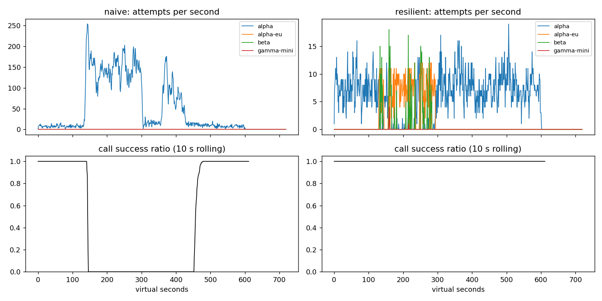

# Lab 25B - Báo cáo Game Day

**Họ tên / nhóm:** Nguyễn Văn Duy - 2A202602729  
**Commit:** `60d584360b3147f5cf521ee36e909c2bcd554305` (bản code đã kiểm thử; commit kế tiếp chỉ thêm báo cáo và bằng chứng)  
**Điểm tự động tại máy:** 84/88. Bốn điểm còn lại dùng bộ SLO ẩn của giảng viên; 12 điểm báo cáo được chấm tay.  
**Tái hiện:** `python -m pytest -q`; `python scripts/grade.py --seeds 25.26,27`; `python scripts/run_report_experiments.py`. Số liệu gốc ở `reports/gameday/`, `reports/cache/`, `reports/workflows.json`, `reports/slo.json`, `reports/experiments.json`.

## 1. Kết quả Game Day

| Băng | Client | Availability | P95 (s) | Amplification | Retry ratio | Cost/lượt tốt | Recovery (s) | Đạt |
| --- | --- | ---: | ---: | ---: | ---: | ---: | ---: | :---: |
| G1 rate limit | naive | 0.7194 | 7.157 | 7.738 | 6.738 | 2.163 | 4 | Không |
| G1 rate limit | resilient | 1.0000 | 4.776 | 1.062 | 0.002 | 2.101 | 0 | Có |
| G2 overload | naive | 0.4560 | 15.034 | 9.904 | 8.904 | 4.627 | 155 | Không |
| G2 overload | resilient | 1.0000 | 10.920 | 1.041 | 0.007 | 2.119 | 0 | Có |
| G3 brown-out | naive | 1.0000 | 4.768 | 1.164 | 0.164 | 2.328 | 0 | Không |
| G3 brown-out | resilient | 1.0000 | 4.660 | 1.060 | 0.034 | 2.145 | 0 | Có |
| G4 slow region | naive | 1.0000 | 13.764 | 1.004 | 0.004 | 2.008 | 0 | Không |
| G4 slow region | resilient | 1.0000 | 5.562 | 1.015 | 0.002 | 2.072 | 0 | Có |
| G5 bad deploy/quota | naive | 0.3699 | 5.359 | 17.030 | 16.030 | 2.124 | Không đo | Không |
| G5 bad deploy/quota | resilient | 0.8179 | 5.477 | 1.003 | 0.002 | 2.504 | Không đo | Có |
| G6 outage | naive | 0.5170 | 4.836 | 12.344 | 11.344 | 2.009 | 0 | Không |
| G6 outage | resilient | 1.0000 | 5.961 | 1.055 | 0.019 | 2.189 | 0 | Có |

Nguồn là seed 25 của `reports/gameday/*.json`. Bản naive trượt 6/6; bản resilient đạt 6/6. `make grade` chạy thêm seed 26 và 27 cũng cho 6/6. G5 không thể đạt 100% availability vì 60% request malformed trong một khoảng; nhiệm vụ của client là không retry lỗi 400 hay chuyển provider vô ích.

## 2. Cấu hình client và lý do

| Tham số | Giá trị | Lý do gắn với số liệu |
| --- | ---: | --- |
| `attempt_timeout_s` | 8 s | G6 đạt 100% availability; thử 30 s chỉ còn 94,88% và 109 lượt hết deadline. |
| `max_attempts_per_provider` | 2 | Một retry tại cùng provider; G3 retry ratio 0.034 so với 0.164 của naive. |
| `min_time_left_s` | 1 s | Tránh gửi attempt không còn thời gian hoàn tất; thí nghiệm timeout 30 s cho thấy 109 lượt bỏ cuộc vì deadline. |
| `backoff_base_s` / `backoff_cap_s` | 0.25 / 4 s | Full jitter thay delay đồng loạt; G2 amplification 1.041 thay vì 9.904. |
| `retry_budget_ratio` / `min_per_s` / `max_tokens` | 0.1 / 0.5 / 20 | Khi vô hiệu hóa breaker, budget giữ G2 amplification 1.383 thay vì 1.677 khi tắt budget. |
| `quota_cooldown_s` | 300 s | G5 hết quota không bị retry tiếp; availability 0.8179 thay vì 0.3699. |
| Breaker `window_size` / `min_calls` | 20 / 10 | Cần đủ mẫu trước khi ngắt; trên G2 đạt recovery 0 s và trên G3 vẫn giữ availability 1.0. |
| Breaker `failure_rate_threshold` | 0.5 | Ngắt deployment có phần lớn kết quả lỗi; G2 amplification chỉ 1.041. |
| Breaker `slow_call_s` / `slow_rate_threshold` | 5 s / 0.6 | G4 không có HTTP lỗi vẫn được nhận diện là chậm: P95 5.562 s thay vì 13.764 s. |
| Breaker `open_duration_s` | 10 s | Thăm dò trở lại sau ngắt; G2 quay về primary ngay sau phục hồi (`recovery_s = 0`). |
| Breaker `half_open_max_probes` / `half_open_successes` | 2 / 2 | Giới hạn probe đồng thời, tránh ồ ạt trở lại provider; G2 amplification 1.041. |

Sơ đồ quyết định của `on_error`:

```text
400/401/403/422 -> release permit -> trả client_error; không retry, không failover
429 rate limit   -> release permit -> cooldown theo Retry-After -> provider kế
429 hết quota    -> release permit -> cooldown dài -> provider kế
529/5xx/timeout  -> báo breaker -> retry cùng provider nếu còn budget và deadline
                                  -> nếu không, bỏ qua provider lỗi và đi tiếp ladder
Ladder            -> chỉ chọn deployment hỗ trợ tool cho tác vụ tool
```

## 3. Ba thí nghiệm đối chứng

1. **Retry budget khi breaker bị cấu hình sai.** Đặt `min_calls = 1.000.000.000`, `max_attempts_per_provider = 5`. G2 có budget: amplification **1.383**, retry ratio **0.058**, recovery **0 s**, availability **99,87%**. Tắt budget: **1.677**, **0.503**, **32 s**, **96,06%**. G3 retry ratio tăng từ **0.068** lên **0.162** khi tắt budget. Khi breaker vận hành đúng, nó giúp ngắt dependency hỏng; budget vẫn là chốt chặn khi breaker chưa đủ mẫu, cấu hình sai hoặc lỗi không làm breaker mở.
2. **Timeout 30 s.** G6 với 8 s đạt **100%** availability, P95 **6.016 s**, không có `give_up`. Với 30 s, availability chỉ **94,88%**, có **109** lượt hết deadline và **13** lượt hết provider; P95 của lượt *thành công* lại giảm còn **5.306 s**. Chỉ nhìn P95 sẽ bỏ sót các lượt thất bại (survivorship bias). G4 gần như không đổi: availability **100%** ở cả hai cấu hình, P95 **5.604** so với **5.683 s**, vì vùng chậm vẫn phản hồi trong thời hạn. Timeout phải chừa thời gian cho fallback trong deadline 30 s, đồng thời tham chiếu phân phối latency bình thường.
3. **Bỏ lọc khả năng tool calling.** G6 với ladder đúng có **0** route không tương thích và availability **100%**. Bỏ lọc tạo **258** route gửi tool call sang model không hỗ trợ tool, availability xuống **89,18%**. Với người dùng, đây là 258 lần agent chọn đường dự phòng nhưng đường đó không thể hoàn thành việc, dù model dự phòng vẫn “đang hoạt động”.

Chi tiết cấu hình và kết quả: `reports/experiments.json`. Mỗi thí nghiệm thay đúng biến được nêu, dùng cùng băng và seed 25; file `scripts/run_report_experiments.py` tái hiện được.

## 4. Workflow hoàn tiền

| Executor | Completion | Worker crash | Hoàn tiền trùng | Email trùng | Hoàn tiền mất | Trả thừa (cent) | LLM lãng phí/crash |
| --- | ---: | ---: | ---: | ---: | ---: | ---: | ---: |
| naive | 1.0 | 81 | 128 | 81 | 0 | 1.496.700 | 1.123 |
| ours | 1.0 | 66 | 0 | 0 | 0 | 0 | 0.303 |

`reports/workflows.json` chứa 500 phiên. **Idempotency key** giữ nguyên theo `(session_id, step)` giúp dịch vụ trả lại kết quả cũ nếu response mất hoặc worker chết sau khi đã hoàn tiền. Nhưng chỉ có key thì bước LLM/lookup vẫn chạy lại và tốn tiền. **Checkpoint sau khi bước thành công** cho phép worker mới bỏ qua bước đã xong. Nếu ghi checkpoint *trước* payment rồi worker chết, lượt tiếp theo sẽ tưởng đã hoàn tiền dù tiền chưa đi; nếu không có key và worker chết *sau* payment nhưng trước checkpoint, lượt sau có thể hoàn tiền lần hai. Hai cơ chế phải đi cùng nhau.

## 5. Alerting và error budget

| Sự cố | Mong đợi | Naive | Burn-rate | Trễ phát hiện của burn-rate |
| --- | --- | --- | --- | ---: |
| `checkout_bug` | Page | Page | Page | 27 phút |
| `provider_outage` | Page | Page | Page | 4 phút |
| `deploy_blip` | Không báo | Page sai | Không báo | - |
| `slow_leak` | Ticket | Bỏ sót | Ticket | 1.337 phút |
| `degraded_evening` | Page | Page | Page | 291 phút |
| `night_spike` | Không báo | Page sai | Không báo | - |
| `small_bump` | Không báo | Page sai | Không báo | - |

Trên `reports/slo.json`, naive tạo **3 false page** và bỏ sót slow leak; burn-rate tạo **3 page, 1 ticket, 0 false page**. Luật yêu cầu cả cửa sổ dài lẫn ngắn vượt cùng ngưỡng: `14.4×` cho 1 giờ/5 phút, `6×` cho 6 giờ/30 phút, `1×` cho 3 ngày/6 giờ. `small_bump` kéo 20 phút ở 12% lỗi nhưng chưa đủ mức tiêu hao ngân sách theo cửa sổ dài, nên không nên gọi on-call chỉ vì một đỉnh ngắn.

Trong 30 ngày có **25.901.755** request, số lỗi cho phép **129.508.8**, thực tế **55.618**; availability **99,7853%**. Đã tiêu **42,95%** error budget, còn **57,05%**, nên **chưa đóng băng release** theo luật `freeze_releases`.

## 6. Postmortem G2 - naive client (blameless)

**Tóm tắt.** Băng G2 làm `alpha` mất 75% năng lực từ giây 120 đến 300. Client naive retry ở ba tầng, không jitter/budget/breaker/fallback, khiến hàng đợi tiếp tục quá tải sau khi provider đã hồi phục. Bản resilient chuyển tải và giới hạn retry, đạt availability **100%** trên cùng seed.

**Ảnh hưởng.** Naive xử lý thành công **1.077/2.362** lượt, làm **1.285** lượt thất bại (**54,4%**); P95 của lượt thành công là **15.034 s**. Provider khôi phục ở t=300 nhưng hệ thống cần thêm **155 s** mới đạt điều kiện phục hồi. Với giả định lấy **25.901.755 request/30 ngày** của bộ SLO làm mẫu số và tháng không có lỗi khác, 1.285 lỗi này tiêu **0,99%** ngân sách **129.508.8** lỗi; chưa vượt toàn bộ budget. Con số là so sánh quy đổi vì băng G2 và dữ liệu SLO là hai mô phỏng khác nhau.



| Giây ảo | Diễn biến | Dữ liệu từ `naive_G2_overload_storm_timeseries.csv` |
| ---: | --- | --- |
| 120 | `alpha` bắt đầu mất năng lực | 5 attempt/s; 7/7 call hoàn tất thành công trong giây này. |
| 150 | Retry storm hình thành | 163 attempt/s; 0/3 call thành công. |
| 240 | Hàng đợi tiếp tục ngập | 105 attempt/s; 0/2 call thành công. |
| 300 | Năng lực `alpha` được phục hồi | 115 attempt/s; 0/5 call thành công. |
| 360 | Lỗi vẫn kéo dài sau phục hồi | 50 attempt/s; 0/1 call thành công. |
| 455 | Bắt đầu hồi phục rõ | 13 attempt/s; 4/5 call thành công. |
| 480 | Trở về ổn định | 8 attempt/s; 11/11 call thành công. |

**Trigger** là mất 75% năng lực GPU. **Nguyên nhân gốc** là client nhân retry ở ba tầng, delay cố định và không chuyển sang deployment còn khỏe. Client timeout nhưng server vẫn xử lý request cũ; những retry mới đổ thêm vào hàng đợi. Vì tải do chính client tạo ra còn cao hơn năng lực phục hồi, sự cố trở thành vòng lặp tự duy trì (metastable failure), không tự hết ở t=300.

Điều giúp ích: simulator giữ seed và CSV nên tái hiện được; cùng băng, client mới có amplification **1.041** thay vì **9.904**, recovery **0 s** thay vì **155 s**. Điều làm tệ hơn: ba tầng retry không có ngân sách, không breaker và không fallback. Đây là lỗi thiết kế hệ thống, không quy cho cá nhân trực ca.

| # | Hành động | Loại | Owner | Cách kiểm chứng |
| ---: | --- | --- | --- | --- |
| 1 | Chỉ cho một tầng retry, full jitter và retry budget | Prevent | Nhóm client/gateway | Trong CI, G2 amplification ≤ 1.6; thử cấu hình breaker sai vẫn ≤ 1.6. |
| 2 | Breaker riêng từng deployment; giới hạn HALF-OPEN probe và chuyển fallback | Mitigate | Nhóm reliability | G2 availability ≥ 95%, recovery ≤ 30 s trên ít nhất 3 seed. |
| 3 | Dashboard attempts/s, queue wait, tỷ lệ call thành công và burn-rate | Detect | On-call/SRE | Cảnh báo tự bật khi 1h và 5m cùng vượt 14.4×; 0 false page trên blip. |
| 4 | Giữ băng G2 và dữ liệu postmortem thành regression gate | Prevent | Nhóm CI/eval | `python scripts/grade.py --seeds 25.26,27` đạt G2 trên cả ba seed trước merge. |

## 7. Điểm yếu còn lại

G2 đã đạt nhưng P95 của lượt thành công vẫn **10.920 s**, cao hơn G1 **4.776 s**, do một phần traffic phải chuyển provider trong lúc `alpha` quá tải. Chi phí/lượt tốt G6 **2.189** so với G1 **2.101** vì provider dự phòng có thể đắt hơn. Bước tiếp theo là thử đặt concurrency limit/bulkhead theo deployment và đo P95, chi phí trên nhiều seed trước khi đổi cấu hình; không đánh đổi availability chỉ để giảm trung bình độ trễ.

## 8. Cache (Part G)

| Client | Availability | FAQ availability | Hit ratio | Stale served | Wrong | Outdated | Cost/lượt tốt | Đạt |
| --- | ---: | ---: | ---: | ---: | ---: | ---: | ---: | :---: |
| resilient, không cache | 0.8373 | 0.8424 | 0 | 0 | 0 | 0 | 1.386 | Không |
| cached | 0.9120 | 0.9645 | 0.681 | 141 | 0 | 13 | 0.896 | Có |

Nguồn bảng: `reports/cache/*.json`, seed 25. Cấu hình cuối: **similarity 0.92**, **TTL 90 s**, **stale window 240 s**, `max_entries` **500**. Ngưỡng 0.92 loại các ý gần nhưng khác: thí nghiệm 0.80 có **165 wrong answers**, tất cả là `other_question`; 0.92 còn **0** với hit ratio **0.681**; 0.97 vẫn 0 wrong nhưng hit giảm **0.623** và outdated tăng **17**. TTL 90 s giữ outdated ở **13**, dưới giới hạn 15: TTL 30 s chỉ **2** outdated nhưng hit **0.591**, TTL 60 s có **3** và hit **0.652**, TTL 300 s có **95** outdated dù hit **0.731**. Webhook chỉ biết nguồn *được báo* là đã đổi; thay đổi phí ship không báo trước cần TTL để giới hạn độ cũ.

Tắt stale-if-error (`max_stale_s = 0`) làm FAQ availability từ **0.9645** xuống **0.8814**, stale served từ **141** xuống **0** trong lần chạy chuẩn; thí nghiệm riêng cùng seed cho **0.9645** xuống **0.8814** và stale served **143** xuống **0**. Chênh lệch số stale giữa hai lệnh là do cách khởi tạo client/seed; kết luận về availability không đổi. Câu hỏi cá nhân không cache, kể cả tách theo user, vì trạng thái đơn hàng/hoàn tiền đổi nhanh và chỉ embedding gần giống không chứng minh dữ liệu vẫn đúng hoặc quyền truy cập còn hợp lệ. Khi cache giữ dashboard user-facing xanh trong lúc provider sập, on-call vẫn cần xem **breaker OPEN, fallback/give-up, stale-served rate và nguồn cache còn tươi hay không**; không chỉ nhìn availability.

Kết quả ba thí nghiệm nằm ở `reports/experiments.json`; `wrong_answers_by_reason` rỗng tại cấu hình cuối. Quy tắc `prompt_version`, cấm cache câu cá nhân, invalidation theo source và giới hạn LRU nằm trong `src/gameday_lab/cache.py`.
